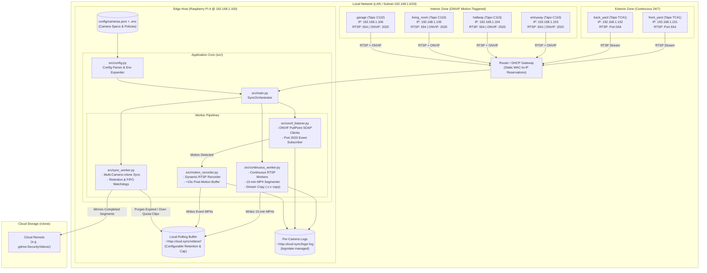
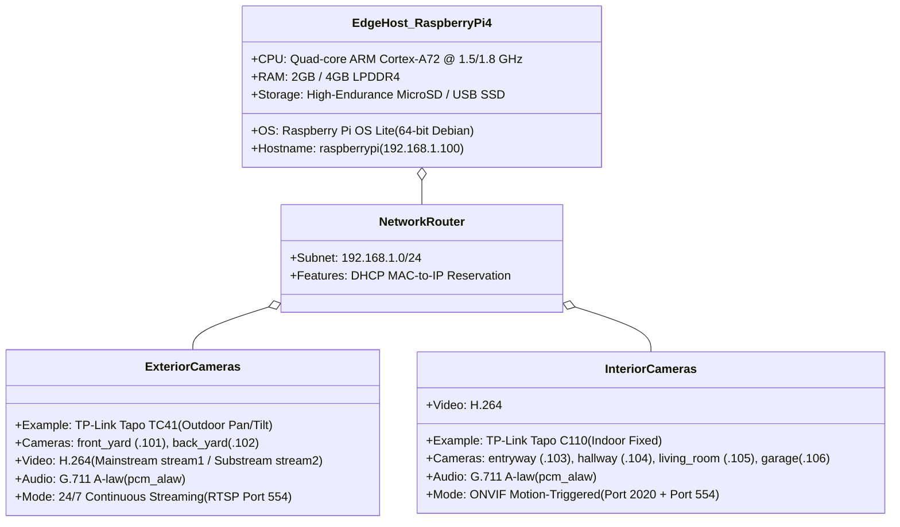
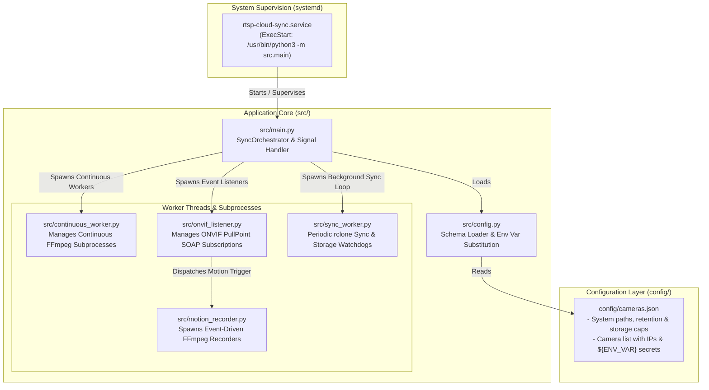
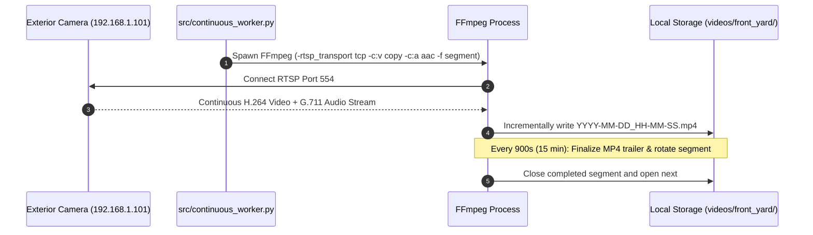
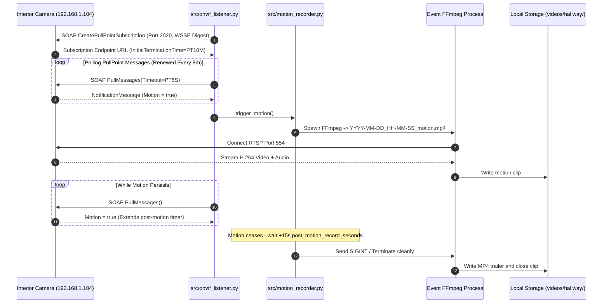
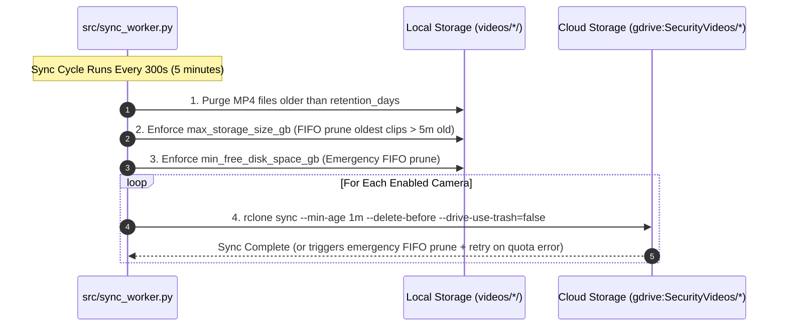

# System Architecture Document

## Project: `rtsp-cloud-sync` (Headless IP Camera RTSP/ONVIF Recorder & Cloud Sync)

---

### 1. High-Level System Architecture

**`rtsp-cloud-sync`** operates as an autonomous, low-overhead edge recording and cloud sync gateway between IP cameras on a local network and `rclone`-backed cloud storage. A single Linux host (such as a Raspberry Pi 4) coordinates continuous 24/7 RTSP capture for exterior cameras and ONVIF event-triggered capture for interior cameras, driven by a declarative `config/cameras.json` file (modeled on [`config/cameras.example.json`](../config/cameras.example.json)) and modular Python workers in [`src/`](../src/).



---

### 2. Reference Hardware Topology



#### Reference Node Table

| Node / Device | Placeholder MAC | Example IP | Primary Role | Protocol Interfaces |
| :--- | :--- | :--- | :--- | :--- |
| **Raspberry Pi 4 (`raspberrypi`)** | Host NIC | `192.168.1.100` | Headless Recorder & Sync Host | SSH (`22`), `rclone` HTTPS |
| **`front_yard`** | `AA:BB:CC:DD:EE:01` | `192.168.1.101` | Exterior Front Perimeter | RTSP TCP (`port 554`) |
| **`back_yard`** | `AA:BB:CC:DD:EE:02` | `192.168.1.102` | Exterior Rear Perimeter | RTSP TCP (`port 554`) |
| **`entryway`** | `AA:BB:CC:DD:EE:03` | `192.168.1.103` | Interior Main Entryway | RTSP (`554`) + ONVIF (`2020`) |
| **`hallway`** | `AA:BB:CC:DD:EE:04` | `192.168.1.104` | Interior Hallway | RTSP (`554`) + ONVIF (`2020`) |
| **`living_room`** | `AA:BB:CC:DD:EE:05` | `192.168.1.105` | Interior Living Area | RTSP (`554`) + ONVIF (`2020`) |
| **`garage`** | `AA:BB:CC:DD:EE:06` | `192.168.1.106` | Interior Garage | RTSP (`554`) + ONVIF (`2020`) |

---

### 3. Modular Software Architecture (`src/`)

The codebase is organized into self-contained Python standard-library modules under [`src/`](../src/) supervised by `systemd`:



#### Module Responsibilities
- [`src/config.py`](../src/config.py): Parses `config/cameras.json`, expands `${VAR}` / `${VAR:default}` environment variables, resolves `~` paths, and constructs RTSP and `rclone` targets.
- [`src/continuous_worker.py`](../src/continuous_worker.py): Supervises 24/7 FFmpeg segmented stream-copy processes with timestamped filenames, clean `SIGINT` MP4 trailer finalization, and 10-second reconnect backoff.
- [`src/onvif_listener.py`](../src/onvif_listener.py): Implements a zero-dependency ONVIF PullPoint SOAP client (`urllib.request` + `xml.etree.ElementTree`) with WS-Security `PasswordDigest` authentication, 5-second `PullMessages` polling, throttled error logging, and proactive 8-minute subscription renewal.
- [`src/motion_recorder.py`](../src/motion_recorder.py): Dynamically launches FFmpeg when motion begins, extends the session while motion persists, appends `post_motion_record_seconds` after motion ends, and cleanly splits long events at `max_event_clip_seconds`.
- [`src/sync_worker.py`](../src/sync_worker.py): Runs periodic retention cleanup, max-folder-size FIFO pruning (`max_storage_size_gb`), low-disk-space emergency FIFO pruning (`min_free_disk_space_gb`), and `rclone sync` (`--min-age 1m --delete-before --drive-use-trash=false`) with automatic retry on cloud quota errors.
- [`src/main.py`](../src/main.py): CLI entrypoint and `SyncOrchestrator` that coordinates worker lifecycles, monitors continuous worker thread health, and handles `SIGINT`/`SIGTERM` shutdowns.

---

### 4. Configuration File Specification (`config/cameras.json`)

Copy [`config/cameras.example.json`](../config/cameras.example.json) to `config/cameras.json` (which is excluded via `.gitignore`):

```json
{
  "system": {
    "local_storage_base": "~/rtsp-cloud-sync/videos",
    "log_dir": "~/rtsp-cloud-sync/logs",
    "rclone_remote_base": "gdrive:SecurityVideos",
    "retention_days": 1,
    "sync_interval_seconds": 300,
    "min_free_disk_space_gb": 5.0,
    "max_storage_size_gb": 15.0
  },
  "cameras": [
    {
      "name": "front_yard",
      "display_name": "Front Yard",
      "model": "Tapo TC41",
      "location": "exterior",
      "mac": "AA:BB:CC:DD:EE:01",
      "ip": "192.168.1.101",
      "username": "cam_user",
      "password": "${CAM_PASS}",
      "rtsp_port": 554,
      "rtsp_stream": "stream2",
      "onvif_port": 2020,
      "recording_mode": "continuous",
      "segment_time_seconds": 900,
      "enabled": true
    },
    {
      "name": "hallway",
      "display_name": "Main Hallway",
      "model": "Tapo C110",
      "location": "interior",
      "mac": "AA:BB:CC:DD:EE:04",
      "ip": "192.168.1.104",
      "username": "cam_user",
      "password": "${CAM_PASS}",
      "rtsp_port": 554,
      "rtsp_stream": "stream2",
      "onvif_port": 2020,
      "recording_mode": "motion",
      "post_motion_record_seconds": 15,
      "max_event_clip_seconds": 300,
      "enabled": true
    }
  ]
}
```

---

### 5. Sequence & Data Flow Diagrams

#### 5.1 Continuous RTSP Capture Pipeline (`continuous`)



#### 5.2 ONVIF Event-Triggered Capture Pipeline (`motion`)



#### 5.3 Cloud Mirror, Retention & Quota Watchdog Pipeline



---

### 6. Key Technical Design Decisions

1. **Zero External Python Dependencies:**
   - *Rationale:* Implementing ONVIF WS-Security `PasswordDigest` headers, SOAP PullPoint requests, XML parsing, and process supervision exclusively with Python's standard library eliminates `pip` dependency breakage on headless Raspberry Pi installations.

2. **Hybrid Capture Strategy (`continuous` + `motion`):**
   - *Rationale:* Recording exterior zones continuously while recording interior zones only on hardware ONVIF motion triggers cuts daily disk writes and upstream bandwidth by >60% without sacrificing perimeter coverage.

3. **Zero-CPU Direct Stream Copy (`-c:v copy`) + Timestamp Sanitization:**
   - *Rationale:* Passing raw H.264 packets directly into MP4 segments while normalizing timestamps (`-fflags +genpts+igndts+discardcorrupt`, `-bsf:v setts=...`, `-af aresample=async=1`) keeps CPU load minimal while preventing playback stutter from Wi-Fi RTSP clock drift.

4. **Quota-Deadlock-Safe Cloud Sync (`--delete-before` + `--drive-use-trash=false`):**
   - *Rationale:* Running local retention and `max_storage_size_gb` pruning *before* `rclone sync --delete-before --drive-use-trash=false` frees cloud storage space prior to uploading new segments, preventing 15 GB free-tier Google Drive accounts from deadlocking on full trash or quota limits.
